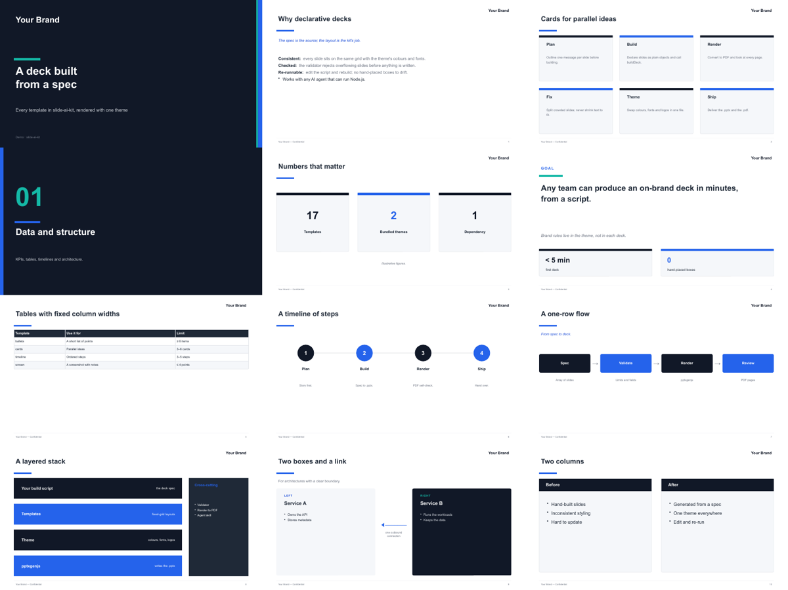
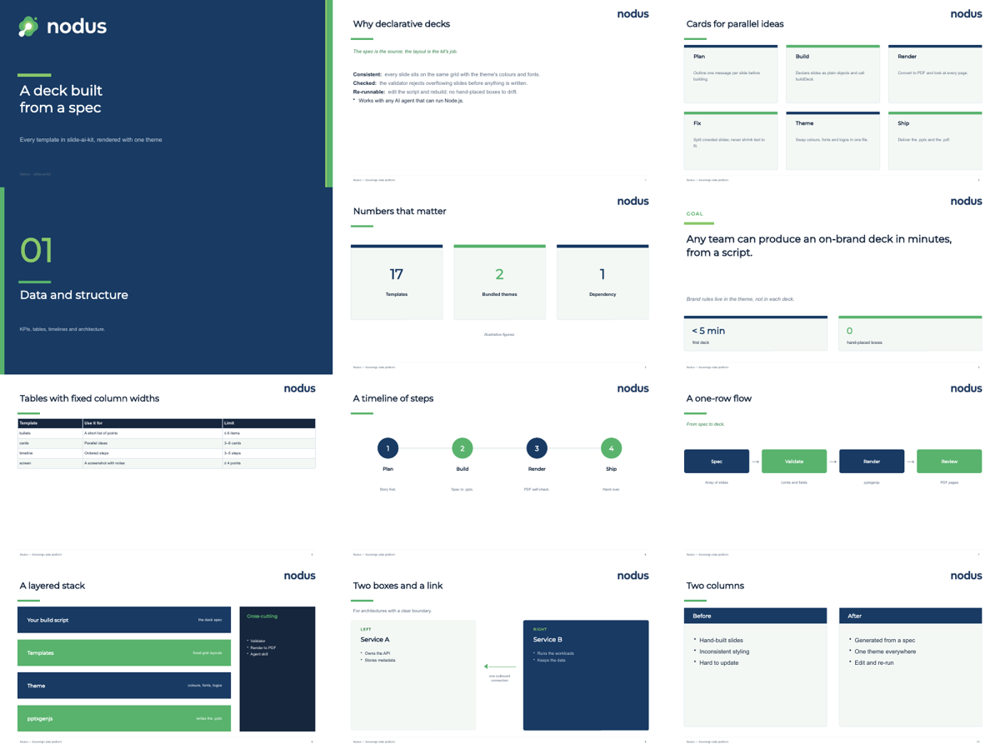

# slide-ai-kit

Themed PowerPoint decks from a declarative spec, made for AI agents (and people who script).

- **17 fixed-grid templates**: cover, section, bullets, cards, KPIs, goal, table, timeline, flow, stack,
  two-column, tracks, Gantt, two-plane architecture, screenshot + notes, hero shot, closing.
- **Themes** hold every brand decision: colours, fonts, logos, footer. Decks never hard-code styling.
- **Validator** rejects overflowing or malformed slides before anything is written.
- **Render-to-PDF** self-check (LibreOffice) so an agent can look at what it built.
- One dependency: [pptxgenjs](https://github.com/gitbrent/PptxGenJS).

| Default theme | Branded theme (Nodus) |
|---|---|
|  |  |
| Neutral slate + blue, the brand name drawn as text | Logo mark + wordmark, brand colours |

## Install

```bash
npm i -g github:sparklabx/slide-ai-kit     # CLI: slide-ai
# or as a project dependency
npm i github:sparklabx/slide-ai-kit
```

Rendering to PDF needs [LibreOffice](https://www.libreoffice.org/) (`soffice` on PATH, or set `SOFFICE`).

## Use

```js
import { buildDeck } from "slide-ai-kit";
import theme from "slide-ai-kit/themes/default";

await buildDeck([
  { t: "title", title: "Quarterly review", subtitle: "Engineering", meta: "Q3 2026" },
  { t: "bullets", title: "Highlights", items: [
    { h: "Shipped:", t: " the new billing flow" },
    "Halved build times",
  ] },
  { t: "kpi", title: "Numbers", kpis: [{ value: "99.95%", label: "Uptime" }, { value: "-48%", label: "Build time" }] },
  { t: "closing", title: "Thank you", contact: "team@example.com" },
], "/abs/path/review.pptx", { theme });
```

```bash
slide-ai render review.pptx   # → review.pdf
slide-ai templates            # every template's fields and limits
npm run demo                  # out/demo-default.pptx and out/demo-nodus.pptx: every template, both themes
```

## Make a theme

Copy `themes/default/theme.mjs` and edit it:

```js
export default {
  name: "Acme",                       // drawn as text when there is no logo
  footer: "Acme — Confidential",
  colors: { dark: "0B1F3A", primary: "E4572E", accent: "F3A712", ink: "1F2937", /* … */ },
  ramp: ["0B1F3A", "E4572E"],         // what cards/steps cycle through (must read with white text)
  fonts: { head: "Montserrat", body: "Arial" },
  logos: {                            // PNGs; aspect = width / height
    word:      { path: "/abs/acme-wordmark.png",       aspect: 3.5 },   // light slides
    wordWhite: { path: "/abs/acme-wordmark-white.png", aspect: 3.5 },   // dark slides
    mark:      { path: "/abs/acme-mark.png",           aspect: 1 },
    markWhite: { path: "/abs/acme-mark-white.png",     aspect: 1 },
  },
  brand: { mark: true, sectionLogo: false },   // mark + wordmark on cover/closing; no logo on section slides
};
```

See `themes/nodus/` for a complete branded theme.

## For AI agents

`skills/slide-ai/SKILL.md` is a ready-made skill (Claude Code and compatible agents): copy or symlink it
into your agent's skills folder. `slide-ai workflow` prints the build loop with absolute import paths.

## License

Apache-2.0. The Nodus logos in `themes/nodus/assets/` belong to the Nodus project and are included only
as a theme example.
